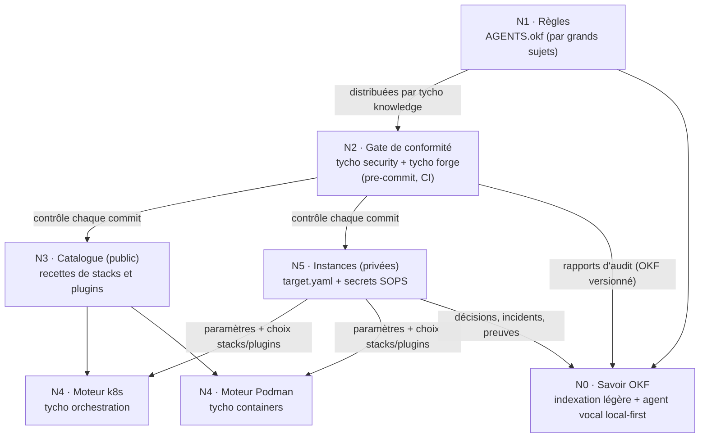

# RFC-001 : Stacks, plugins et cibles

> **Statut** : Acceptée le 2026-11-05 (amendements : §3 réseau public et parcours d'installation guidé, §4quinquies modules en paquets npm, §5 modes Podman légers et Kubernetes local, §8 GitHub et artefacts, §9 priorités)
> **Auteur** : crapougnax
> **Date** : 2026-10-24
> **Périmètre** : `tycho/*` (cœur et modules), catalogue de recettes, dépôts d'instance (`<org>/<engine>-<provider>-<cible>`), `AGENTS.okf`

---

## 0. Contexte et motivation

L'infrastructure de référence doit être **dupliquée rapidement** (autres domaines, autres organisations, autres hébergeurs) et rester **auditable** (ISO 27001). L'état actuel l'empêche :

- Recettes et configuration d'instance sont mêlées : domaines, IP et noms de cluster codés en dur dans les manifests.
- Plusieurs copies divergentes des mêmes recettes (publique, privée, locale) ; cette confusion entre public et privé a déjà conduit à exposer un jeton.
- Les règles destinées aux agents (`AGENTS.okf`) ne sont pas appliquées mécaniquement : une consigne n'est pas un contrôle.
- Ce qui se fait sur Kubernetes (`tycho orchestration`) n'a pas d'équivalent garanti sur un hôte Podman (`tycho containers`).

### Finalité

**Recenser tout le savoir en OKF** — règles, recettes, décisions, incidents, résultats d'audit — avec une **indexation légère** et un **agent vocal local-first** pour l'interroger et planifier. Tycho est l'outil qui produit, contrôle et exploite ce savoir ; le déploiement et la sécurité en sont des producteurs et des consommateurs.

Cette RFC fixe le **cadre** à plusieurs niveaux. Les choix d'implémentation feront l'objet de RFC filles.

---

## 1. Vocabulaire (normatif)

| Terme | Définition | Exemples |
| :--- | :--- | :--- |
| **Module** | Sous-fonction de la CLI Tycho, paquet npm `@tycho/<module>` chargé et exécuté par le cœur `tycho` (§4quinquies) | `forge`, `containers`, `orchestration`, `knowledge`, `security` |
| **Stack** | Installation spécifique d'un logiciel, décrite par une recette générique et paramétrable | `traefik`, `forgejo`, `keycloak`, `lorawan`, `mail`, `shlink` |
| **Plugin** | Addendum à une stack : modifie ou étend une stack existante, n'existe pas seul | `traefik/forward-auth`, `traefik/crowdsec`, `traefik/access-logs`, `keycloak/theme-<org>` |
| **Cible** (*target*) | Environnement d'exécution d'une instance : un cluster Kubernetes **ou** une machine Podman | `eu1-paris` (k8s), `edge-01` (podman) |
| **Recette** (*recipe*) | Définition générique d'une stack ou d'un plugin, sans aucune valeur d'instance | `catalog/stacks/forgejo/`, `<repo>/.tycho/` |
| **Descripteur `.tycho/`** | Dossier à la racine d'un dépôt applicatif décrivant le ou les services qu'il rend déployables, et leurs recettes | `acme/shop/.tycho/` |
| **Instance** | Ensemble des cibles d'une organisation et de leur configuration (paramètres + secrets) | `acme/k8s-scaleway-eu1-paris` |
| **Organisation** | Celui pour qui l'opérateur gère des cibles ; regroupe les cibles dans `tycho` (§3, *Organisations et cibles multiples*) | `acme`, `default` |
| **Host** (*hébergeur*) | Organisation qui **opère** une cible : infrastructure (IP, réseau, cluster), services partagés (ingress, TLS, SSO, GitOps) et périmètre accordé à chaque tenant | `acme` sur `acme/k8s-scaleway-eu1-paris` |
| **Tenant** (*hébergé*) | Organisation dont les charges tournent sur la cible d'un host, pilotées depuis **son propre dépôt**, dans le périmètre que le host lui accorde | `globex` sur la cible de `acme` |

Host et tenant sont deux **modes imbriqués**, pas deux sortes d'organisations : une cible a **un** host et zéro, un ou plusieurs tenants ; une même organisation peut être host de ses cibles et tenant sur celle d'un autre (§3, *Host et tenants*). « Hôte » n'est jamais employé pour une machine : on dit *machine Podman*.

Règle : **une recette ne contient jamais** de domaine, d'IP, de nom de cible, d'identifiant ou de secret. Tout ce qui varie d'une instance à l'autre est un **paramètre**.

---

## 2. Architecture en niveaux



| Niveau | Contenu | Visibilité | Dépôt(s) |
| :--- | :--- | :--- | :--- |
| N0 Savoir | Tout le savoir en OKF, indexé, interrogeable à la voix | Selon la source | `tycho knowledge` + dépôts OKF |
| N1 Règles | Fiches OKF atomiques, rangées par piliers (Usine logicielle, Déploiement, Cybersécurité) | Public | `AGENTS.okf` |
| N2 Gate | Implémentation mécanique des règles vérifiables | Public | `tycho/modules` (`security`, `forge`) |
| N3 Recettes | Catalogue officiel, catalogues tiers déclarés, descripteurs `.tycho/` | **Selon le dépôt** : public ou privé (cf. §4quater) | `tycho/catalog`, catalogues tiers, `<repo>/.tycho/` |
| N4 Moteurs | Rendu et application des recettes sur une cible | Public | `tycho/modules` (`orchestration`, `containers`) |
| N5 Cibles | Paramètres, sélection, secrets chiffrés — un dépôt par cible | **Privé** | `<org>/<engine>-<provider>-<cible>` |

Conséquence directe : **la frontière « instance / générique » passe entre N3 et N5**. Une recette ne contient jamais d'élément d'instance, qu'elle soit publique ou privée ; le gate (N2) le vérifie. La visibilité d'un dépôt de recettes est une propriété distincte (§4quater).

---

## 3. Le manifeste de cible (`target.yaml`)

Source unique de vérité d'une cible, consommée par les deux moteurs **et** par Terraform.

```yaml
# instance: acme/k8s-scaleway-eu1-paris — target.yaml
apiVersion: tycho.qtrn.io/v1alpha1
kind: Target
metadata:
  name: eu1-paris
spec:
  engine: kubernetes            # kubernetes | podman
  provider: scaleway            # scaleway | hetzner | aws | baremetal
  domain: example.com
  catalogs:                     # catalogue officiel implicite ; catalogues tiers explicites
    - name: tycho
      url: https://git.qtrn.io/tycho/catalog.git
      ref: v1.4.0               # tag, jamais une branche en production
    - name: acme-recipes        # catalogue partenaire sous accord, même format
      url: https://git.example.org/acme/tycho-catalog.git
      ref: v0.3.2
      trust: partner            # cf. §4ter — signé par une clé enregistrée par Tycho
  network:
    ingressIP: 203.0.113.10
    proxyProtocol: true
  secrets:
    sops:
      recipients: [admin-1, target-eu1-paris]   # identités, résolues dans .sops.yaml
  stacks:
    traefik:
      plugins: [proxy-protocol, forward-auth, crowdsec, access-logs]
      params: { accessLogs: { backend: loki, retention: 180d } }
    keycloak: {}
    forgejo:
      params: { host: git }     # → git.example.com
    lorawan: {}
    shlink:
      params: { path: /go, adminHost: links, tracking: false }   # → example.com/go/<code>
```

Principes :
- **Déclaratif et complet** : ce qui n'est pas dans `target.yaml` n'est pas installé (pas de défaut implicite côté instance).
- **Fail-fast** : un paramètre requis par une recette et absent fait échouer le rendu, sans valeur de repli.
- Le même fichier sert à `terraform` (réseau, DNS, LB) : plus de double saisie.

**Convention de nommage des dépôts de cible** : `<org>/<engine>-<provider>-<cible>` — un dépôt par déploiement ; le nom annonce ce que contient le dépôt (paramètres k8s chez Scaleway, Podman sur bare-metal…). Chaque dépôt a ses propres destinataires SOPS et son propre rythme de mise en production. *Confirmé le 2026-11-05, de préférence à un dépôt par opérateur avec un dossier par cible.*

| Exemple | Contenu |
| :--- | :--- |
| `acme/k8s-scaleway-eu1-paris` | Cluster Kapsule `eu1-paris` |
| `acme/podman-baremetal-edge-01` | Hôte Podman en périphérie |
| `<autre-org>/k8s-hetzner-fsn1` | Instance d'une autre organisation, autre hébergeur |

---

### Organisations et cibles multiples *(amendement du 2026-11-06)*

Un même `tycho` gère plusieurs **organisations** (une par instance : un client, une entreprise),
chacune avec plusieurs **cibles**. Leur liste appartient au **cœur**, pas aux modules :
`tycho context add <dépôt>` enregistre une cible sous le nom lu dans son `target.yaml`
(`metadata.name`), dans l'organisation qu'il déclare (`metadata.organization`, sinon `--org`, sinon
l'organisation courante), avec son moteur (`spec.engine`). L'identifiant unique d'une cible sur un
poste est `org/nom` : deux organisations peuvent avoir chacune une cible `production`. Un
utilisateur mono-organisation reste sur `default` sans jamais en parler.

Sélection, sans jamais de choix implicite : organisation `--org`, sinon `TYCHO_ORG`, sinon
l'organisation courante (`tycho org use`) ; cible `--target` (`nom` ou `org/nom`), sinon
`TYCHO_TARGET`, sinon la cible courante de l'organisation (`tycho context use`). Chaque module reçoit
du cœur la cible sélectionnée et ne traite que celles de son moteur (`orchestration` : kubernetes,
`containers` : podman) ; les modules transverses (`security`, `cost`, `dashboard`) utilisent la même
sélection.

### Host et tenants *(amendement du 2026-11-08)*

Une cible est **opérée par un host** et **accueille des tenants**. Le host est l'organisation dont
le dépôt de cible contient le `target.yaml` : elle seule décide de l'infrastructure et du
périmètre de chacun. Un tenant décrit ses stacks dans **son propre dépôt** et ne choisit ni son
périmètre, ni ses droits, ni l'entrée d'un autre tenant.

Les services de plateforme du host (ingress, TLS, SSO, GitOps, sauvegarde) sont eux-mêmes rangés
comme ceux d'un tenant : le host est le premier tenant de sa propre cible.

La séparation par tenant a deux objectifs :

1. **Pouvoir séparer la cible le moment venu** : tout le périmètre d'un tenant (dépôt,
   namespaces, secrets, volumes) est déjà isolé ; il peut partir sur sa propre cible, dont il
   devient alors le host, sans être démêlé des autres.
2. **Calculer le coût de chaque tenant** : chaque namespace porte le label `<domaine>/tenant` ;
   le coût d'un tenant est la part de capacité des nœuds demandée par ses namespaces, plus ses
   volumes, ses buckets et ses options dédiées (`tycho cost`).

Options par tenant, décidées par le host :

| Option | Défaut | Effet |
| :--- | :--- | :--- |
| Load balancer et IP publique dédiés | non (entrée partagée du host) | Entrypoint propre, isolation de ses routes par une politique d'admission, IP réservée dans `public-ips` |
| Relais SMTP | **oui, propre au tenant** dès qu'il envoie des e-mails | Son compte chez l'opérateur d'e-mail et son domaine d'envoi : quotas et réputation séparés de ceux des autres |
| Sortie contrôlée | non | Proxy L7 et IP de sortie unique pour ses namespaces |

Dans `target.yaml`, les tenants sont déclarés par le host :

```yaml
spec:
  tenants:
    - name: globex
      repository: https://git.example.com/globex/k8s-scaleway-eu1-paris.git
      namespaces: [globex-shop, globex-api]
      kinds: [ConfigMap, Secret, Service, PersistentVolumeClaim, Deployment, Certificate, IngressRoute]
      ingress: shared            # shared | dedicated (frontend de spec.network.ingress)
      mail: { relay: own }       # propre au tenant dès qu'il envoie des e-mails
```

`tycho orchestration` en génère le contrat GitOps (projet, générateur d'applications, accès en
lecture à son dépôt, label des namespaces) ; `tycho cost` y lit la répartition des coûts.

### Réseau public de la cible *(amendement du 2026-11-06)*

Trois paramètres réseau, déclarés dans `spec.network` :

| Paramètre | Valeurs | Défaut |
| :--- | :--- | :--- |
| `publicIps` | `ephemeral` : IP créées et détruites avec la cible (bac à sable, démo) · `durable` : IP réservées dans un état Terraform dédié (`public-ips`), protégées par `prevent_destroy`, lues par la cible sans jamais lui appartenir, inventoriées dans la documentation de la cible | **aucun** (obligatoire) |
| `egressGateway` | `true` / `false` : passerelle de sortie à IP unique. En `durable`, son IP est elle aussi réservée dans `public-ips` ; elle peut y rester réservée passerelle coupée | **aucun** (obligatoire) |
| `reverseDns` | Nom inverse (PTR) facultatif par adresse : `ingress`, `ingressV6`, `egress` | aucun reverse déclaré |

Une IP réservée sans passerelle active est autorisée et signalée « réservée, inutilisée » dans l'inventaire ; une passerelle activée en `durable` sans IP de sortie réservée fait échouer le plan.

### Parcours d'installation guidé *(amendement du 2026-11-06)*

L'installation d'une cible (`tycho orchestration init|apply <cible>`) est un **parcours interactif, reprenable** :

1. **Questions** : chaque paramètre obligatoire sans défaut (`publicIps`, `egressGateway`, fournisseur, domaine…) est demandé ; les réponses sont écrites dans `target.yaml`. Rien n'est supposé.
2. **Plan** : Tycho affiche les étapes et, pour chacune, les **contrôles** qui en conditionnent la suite (plans Terraform sans destruction, ressources attendues, enregistrements DNS).
3. **Exécution avec points d'arrêt** : quand une étape dépend d'une action humaine hors de portée de Tycho, le parcours **s'interrompt** et affiche ce qui est attendu. Cas obligatoire : après la réservation des IP, Tycho liste les enregistrements DNS à créer (A/AAAA vers les IP obtenues, et le nom de chaque reverse demandé).
4. **Vérification avant reprise** : à la reprise (`tycho orchestration apply <cible> --resume`), Tycho vérifie lui-même que les IP existent et correspondent à l'inventaire, que chaque nom résout vers son adresse, **puis** applique les reverse (Scaleway exige que le nom pointe déjà vers l'adresse) et vérifie la cohérence directe/inverse. Tant qu'un contrôle échoue, le parcours reste interrompu et en donne le diagnostic.
5. **État du parcours** : l'étape atteinte et les contrôles passés sont enregistrés dans le dépôt de la cible (journal OKF), de sorte qu'un autre poste puisse reprendre.

---

## 4. Recettes : deux sources, un seul contrat

| Source | Pour quoi | Où |
| :--- | :--- | :--- |
| **Catalogue** | Services populaires dont les éditeurs ne fourniront pas de recette Tycho (Traefik, Forgejo, Keycloak, ChirpStack, Postfix, Shlink, Loki…) | `tycho/catalog` |
| **Descripteur `.tycho/`** | Services développés en interne ou par des tiers qui adoptent Tycho : le dépôt **se décrit lui-même** | `<repo>/.tycho/` |

Les deux suivent **le même contrat** (§4.1, §4.2) : une cible peut combiner des stacks du catalogue et des stacks issues de dépôts. Un descripteur peut aussi déclarer des **plugins** pour des stacks du catalogue (ex. un thème Keycloak livré avec l'application).

```
<repo>/.tycho/
  repository.yaml     # métadonnées du dépôt (remplace repository.json)
  stacks/<service>/   # même structure que catalog/stacks/<stack>/
  plugins/<stack>/<plugin>/
```

État existant : des descripteurs limités aux métadonnées, et des exemples plus anciens sur GitHub, **obsolètes** — à migrer vers ce format lors du déménagement vers Forgejo.

## 4bis. Contrats des recettes

### 4.1 Stack

```
catalog/stacks/<stack>/
  stack.yaml          # métadonnées : version, paramètres (schéma), dépendances, routes, secrets déclarés
  base/               # sous-ensemble Kubernetes portable (cf. §5)
  engines/
    kubernetes/       # spécifique k8s : IngressRoute, Certificate, StorageClass, NetworkPolicy
    podman/           # spécifique Podman : unités Quadlet, config Traefik (file provider)
  plugins/<plugin>/   # plugins propres à cette stack
  tests/              # rendu de référence + vérifications (gate)
```

`stack.yaml` déclare (sans valeur d'instance) :
- **params** : schéma typé (requis / optionnel, format) — validé avant rendu ;
- **requires** : stacks et plugins préalables (ex. `shlink` → `traefik/forward-auth` pour son UI d'admin) ;
- **routes** : hôtes et chemins exposés, abstraits du moteur (`{host}.{domain}`) ;
- **secrets** : noms et clés attendus, jamais les valeurs ;
- **data** : volumes persistants et leur politique de sauvegarde.

### 4.2 Plugin

Un plugin **modifie** une stack (patch / composant), il ne déploie rien seul. Il peut toutefois **exiger** une autre stack (ex. `traefik/crowdsec` → stack `crowdsec` ; `traefik/access-logs` avec backend `loki` → stack `loki`).

Exemples Traefik :

| Plugin | Effet k8s | Effet Podman |
| :--- | :--- | :--- |
| `proxy-protocol` | annotation LB + `trustedIPs` | `trustedIPs` sur l'entrypoint de l'hôte |
| `forward-auth` | Middleware `forward-auth` + oauth2-proxy | idem via file provider |
| `crowdsec` | bouncer Traefik + exige stack `crowdsec` | idem |
| `access-logs` | args `--accesslog` + expédition (Loki) | idem (journald → Loki) |

---

## 4ter. Extensions : écosystème fermé, partenaires sous accord

Principe : **aucun outil tiers ne se greffe librement aux outils Tycho**. Un plugin, un catalogue ou une extension de code est soit développé par Tycho, soit proposé par un **partenaire** dans le cadre d'un **accord négocié** (mode « officiel » partenaire : clé de signature enregistrée + accord de distribution). Il n'existe pas de niveau « communautaire » ouvert.

Tycho fournit les **interfaces TypeScript** (contrats `Stack`, `Plugin`, `Catalog`) aux partenaires ; l'ouverture des interfaces ne vaut pas autorisation de distribution.

| Niveau | Éditeur | Conditions | Cibles autorisées |
| :--- | :--- | :--- | :--- |
| `dev` | Tycho ou partenaire, en cours de développement | Branche ou chemin local, mode `sandbox` uniquement | **Jamais** une cible `standard` ou `hardened` |
| `official` | Tycho | Version taguée **signée** par une clé Tycho, empreinte figée dans `.tycho/lock` | Toutes |
| `partner` | Partenaire sous accord | Version taguée **signée** par la clé du partenaire, **enregistrée par Tycho** dans `allowed_signers` ; accord de distribution en vigueur (référence et date d'expiration dans le registre des partenaires) | Toutes, dans le périmètre de l'accord |

**Éligibilité partenaire** : le partenariat est réservé aux organisations **certifiées au plus haut niveau disponible** dans leur région, au niveau européen comme mondial. Le référentiel exigé est fixé région par région dans le modèle d'accord ; exemples indicatifs, à valider :

| Région | Exigence indicative |
| :--- | :--- |
| Union européenne | Plus haut niveau de certification cyber européen en vigueur pour leur activité (ex. schéma EUCS au niveau le plus élevé lorsqu'il est applicable) ; qualification nationale de plus haut niveau le cas échéant (ex. SecNumCloud en France) ; ISO/IEC 27001 |
| Hors UE | ISO/IEC 27001 sur le périmètre concerné, complétée par l'attestation de plus haut niveau reconnue localement (ex. SOC 2 Type II) |

La certification doit couvrir le périmètre de développement et de distribution de l'extension et **rester valide pendant toute la durée de l'accord** : sa perte ou son expiration suspend l'accord (clé retirée de `allowed_signers`, cf. ci-dessous).

Conséquences :
- Les **catalogues tiers** (§3) suivent la même règle : seuls `official` et `partner` sont déclarables.
- Fin d'un accord ou compromission d'une clé : la clé est retirée de `allowed_signers`, les extensions concernées sont refusées au prochain rendu, l'événement est journalisé (§7ter).
- Plus besoin de bac à sable pour le code TS de tiers inconnus : seul du code signé par Tycho ou par un partenaire sous accord s'exécute.

Inspection (`tycho sec inspect <extension>`), affichée **avant** activation, y compris pour `official` et `partner` :
1. Provenance : éditeur, URL, tag, empreinte, signature, accord partenaire en vigueur.
2. Audit statique (§7.1) appliqué à l'extension.
3. **Capacités déclarées** : ressources créées ou patchées, accès réseau, secrets lus.
4. **Diff de rendu** sur la cible : ce que l'activation changerait réellement.
5. Pour le code TS : SBOM et CVE.

L'acceptation est enregistrée (qui, quand, quelle empreinte) dans le dépôt de cible : elle sert de preuve d'audit. Toute nouvelle version repasse par l'inspection.

**Signature (décision)** :
- **Tags git signés par clé SSH** (`git tag -s`, vérification via un fichier `allowed_signers` publié par le catalogue) pour tout ce qui est distribué par git : aucun outil supplémentaire, clés déjà en place, vérification affichée par Forgejo, fonctionnement hors ligne.
- **minisign** pour les artefacts hors git (binaire du cœur, paquets npm des modules, archives, `.deb`), tous publiés uniquement sur l'infrastructure qtrn.io.
- **Écartés en v1** : sigstore keyless (dépend des services publics Fulcio / Rekor, contraire au local-first et à la souveraineté) et la provenance npm (liée aux CI GitHub / GitLab, indisponible sur Forgejo). À réexaminer si un écosystème public de catalogues émerge.

## 4quater. Dépôts de recettes privés

Un dépôt porteur d'un descripteur `.tycho/` (catalogue ou dépôt applicatif) **n'est pas forcément public** : produits propriétaires d'une organisation, recettes internes, catalogue d'un partenaire sous accord. Tycho ne présume jamais qu'une source est publique.

| Règle | Contenu |
| :--- | :--- |
| **Visibilité déclarée** | `repository.json` (puis `repository.yaml`) déclare `visibility: public \| private`. Tycho la confronte à l'API de la forge quand c'est possible, et refuse un écart (un dépôt annoncé `private` lisible anonymement, ou l'inverse). |
| **Accès authentifié** | Dans `target.yaml`, chaque catalogue porte un bloc `access` : `method: anonymous \| token \| ssh-deploy-key \| oci`, plus `credentialRef` vers un fichier SOPS du dépôt de cible. Le credential est **en lecture seule**, limité à ce dépôt, inscrit au ledger (RFC-003) et révoqué avec la cible. |
| **Bootstrap** | La liste fermée des secrets de bootstrap (§6) s'étend aux credentials de lecture des catalogues privés consommés par la cible : ils doivent être joignables par le moteur de rendu (CMP Argo, poste admin, CI). |
| **Sens des dépendances** | Une recette privée peut dépendre (`requires`) de recettes publiques ; **une recette publique ne peut jamais dépendre d'une recette privée**. Le gate le refuse. |
| **Contenu** | Une recette privée reste générique pour ses cibles (aucun secret, aucune valeur d'instance, paramètres déclarés). Elle peut porter le vocabulaire de son organisation, puisque son audience est restreinte. Rendre public un dépôt privé exige un passage du gate en règles « public » (confidentialité) **avant** le changement de visibilité, ainsi que la purge ou le renouvellement de l'historique s'il contient des éléments sensibles. |
| **Vendoring** | `tycho vendor` ne copie une recette privée que dans un dépôt de cible privé, jamais dans un dépôt public. Le verrou (`.tycho/lock`) en conserve l'empreinte. |
| **Confiance** | Nouveau niveau `organization` (§4ter) : catalogue privé signé par une clé de l'organisation, enregistrée dans les `allowed_signers` de **ses** cibles uniquement. Ce niveau est valable pour les cibles de cette organisation, et jamais pour celles d'une autre. |
| **Licence** | Une recette privée peut être propriétaire (`license` déclaré) ; Tycho l'affiche à l'inspection (`tycho sec inspect`). |

Exemple de cible combinant un catalogue public et un catalogue privé :

```yaml
spec:
  catalogs:
    - name: tycho
      url: https://git.qtrn.io/tycho/catalog.git
      ref: v1.0.0
      access: { method: anonymous }
    - name: acme-products
      url: ssh://git@git.example.org/acme/products.git
      ref: v2.3.1
      trust: organization
      access: { method: ssh-deploy-key, credentialRef: secrets/catalog-acme-products.enc.yaml }
```

## 4quinquies. Modules : paquets npm exécutés par le cœur *(amendement du 2026-11-05)*

Le **cœur** `tycho` est le seul exécutable : un binaire Bun compilé (`bun build --compile`) par plateforme (linux amd64/arm64, darwin arm64/x64). Il embarque le runtime Bun et **exécute lui-même les modules**, qui sont des paquets npm `@tycho/<module>` en JavaScript portable. Aucun runtime n'est requis chez l'utilisateur.

| Sujet | Règle |
| :--- | :--- |
| **Distribution** | Modules publiés **uniquement** sur le registre npm de Forgejo de l'organisation `Tycho`, exposé à la racine du domaine nu (`@tycho:registry=https://qtrn.io/`, routage par scope : scope = organisation) ; le binaire du cœur sur les releases de `git.qtrn.io`. Aucun artefact ailleurs (pas de registre npm public, pas de releases GitHub). |
| **Installation** | Par le cœur seulement : `tycho module add <module>[@<plage>]` installe dans `~/.local/share/tycho/modules` (ou `/usr/local/share/tycho/modules` en mode système), avec un verrou (`modules.lock`) ; jamais par `npm install -g`. |
| **Contrat** | `package.json` porte un bloc `"tycho": { "module": "<nom>", "commands": [...], "core": "^1.0.0", "trust": "official \| partner \| dev" }` ; le point d'entrée exporte `run(args, ctx)`. Le cœur refuse un module dont la plage `core` ne couvre pas sa version. |
| **Intégrité** | Empreinte sha512 du tarball (verrou) **et** signature minisign vérifiée avant chaque chargement (§4ter) ; un module `dev` n'est chargé qu'en mode sandbox. |
| **Dépendances** | Zéro dépendance d'exécution par défaut ; toute dépendance est justifiée, épinglée et revue (chaîne d'approvisionnement). |
| **Modules en shell** | Autorisés pendant la transition : le paquet embarque le script et un point d'entrée qui l'appelle. Réécriture en TypeScript progressive. |
| **Alias** | Aucun alias historique en 1.0.0 (`git`, `podman`, `k8s`, `tycho-sec`…) ; seul l'alias court `tycho sec` est conservé. |

Raisons : un seul artefact lourd (~60 Mo, le runtime) au lieu d'un par module et par plateforme ; modules de quelques Ko, versionnés en semver et vérifiables ; les niveaux de confiance du §4ter s'appliquent tels quels aux paquets. Vérifié le 2026-11-05 : un binaire compilé charge un module externe à l'exécution (`import()` dynamique) et peut servir de runtime (`BUN_BE_BUN=1`).

## 5. Parité Kubernetes / Podman

Exigence : **tout ce que fait `tycho orchestration` doit pouvoir être fait de la même manière par `tycho containers`**, avec la même recette et le même `target.yaml` (seul `engine` change).

### Options

| Option | Principe | Pour | Contre |
| :--- | :--- | :--- | :--- |
| **A. YAML Kubernetes comme langue commune** | `base/` = sous-ensemble k8s exécutable par `podman kube play` (Pod/Deployment, ConfigMap, Secret, PVC) ; écarts dans `engines/` | Une seule définition, outillage standard, Podman le supporte nativement (Quadlet `.kube`) | Sous-ensemble à discipliner (pas de CRD dans `base/`) |
| B. Format abstrait Tycho | `stack.yaml` complet, rendu vers k8s et vers Podman | Indépendance totale | Un DSL de plus à maintenir et documenter |
| C. Deux définitions (Kustomize + Compose) | Chaque moteur a sa recette | Simple au début | Double maintenance, divergence garantie — **rejetée** |

**Proposition : option A**, complétée par les métadonnées de `stack.yaml` (routes, params, secrets) qui alimentent les deux moteurs. Le gate vérifie que `base/` reste portable (`podman kube play --dry-run` en CI).

### Modes d'exécution Podman *(amendement du 2026-11-05)*

Le moteur Podman sert d'abord un usage **léger** : un développeur qui lance une stack sur son poste en quelques secondes, ou un particulier qui fait tourner quelques services sur un petit serveur, avec une observation simple. Les modes, du recommandé au plus rapide :

| Mode | Principe | Supervision / observation | Statut |
| :--- | :--- | :--- | :--- |
| `quadlet-system` | Unités Quadlet dans `/etc/containers/systemd/`, applications en rootless sous des utilisateurs dédiés (`User=`) | systemd (démarrage au boot, redémarrage, dépendances), journald | **Recommandé** (serveur) |
| `quadlet-user` | Unités Quadlet dans `~/.config/containers/systemd/`, `loginctl enable-linger` | systemd `--user`, journald | Autorisé (poste de dev, serveur personnel) |
| `compose` | `compose.yaml` **généré** par `tycho render --format compose`, lancé par `podman compose` en mode utilisateur | Politiques `restart:` + `podman-restart` utilisateur, journald | **Déconseillé**, conservé pour un démarrage rapide ; Tycho affiche l'avertissement |

Règles :
- `compose.yaml` est une **sortie de rendu**, jamais une seconde recette maintenue à la main : l'option C reste rejetée.
- Aucun mode n'exige de monter la socket Podman dans un conteneur : les routes du reverse proxy sont générées par le rendu (fichiers dynamiques), pas découvertes par labels.
- Tout conteneur rendu porte une politique de redémarrage explicite ; un mode sans supervision effective (ex. `podman-restart` non activé pour l'utilisateur) est signalé par `tycho containers status`.

### Kubernetes local : kind et k3s *(amendement du 2026-11-05)*

Les recettes doivent aussi tourner sur un Kubernetes local — **kind sous Podman** (poste de dev) et **k3s** (petit serveur) — via `tycho orchestration`, avec un fournisseur `local` dont les liaisons remplacent celles du cloud : classe de stockage `local-path`, exposition par `hostPort` / `servicelb` au lieu du load balancer, émetteur de certificats autosigné ou ACME selon l'accès Internet. Les recettes n'ont pas à changer : seules les liaisons de fournisseur diffèrent.

**Priorité** : ces modes (compose, Quadlet utilisateur, kind, k3s) ne doivent pas retarder la séparation des dépôts (§9 phase 2). S'ils s'avèrent trop coûteux à livrer en une fois, ils sont reportés après la phase 4.

### Rendu unique

Le rendu (paramètres → manifests) est fait **par Tycho**, pas par chaque moteur :
- Podman : `tycho containers apply <target>` → rendu → `podman kube play` / Quadlet.
- Kubernetes sans Argo : `tycho orchestration apply <target>` → rendu → `kubectl apply`.
- Kubernetes avec Argo : Argo appelle le même rendu via un **Config Management Plugin** (`tycho render`) dans le repo-server. GitOps conservé, un seul moteur de rendu.

---

## 6. Secrets et clés

### Acquis (en production)

- SOPS + age ; seules `data` / `stringData` chiffrées ; fichiers `*.enc.yaml`.
- **Une clé age par identité** (admin, cible), jamais par projet ; `.sops.yaml` décide qui déchiffre quoi.
- Tout secret migré est **régénéré** ; tout secret vu hors de son coffre est renouvelé.
- Tokens de service dédiés, scope minimal (`read:repository`, `read:package`).

### À trancher : la clé privée de la cible « au repos »

Aujourd'hui, la clé age de la cible est un `Secret` Kubernetes (`argocd/sops-age`), donc **en clair dans etcd** si le chiffrement au repos d'etcd n'est pas actif. Idée issue du refactoring : stocker cette clé **chiffrée** côté cible.

| Option | k8s | Podman | Remarque |
| :--- | :--- | :--- | :--- |
| a. Chiffrement etcd au repos | `EncryptionConfiguration` (auto-géré) ; **Kapsule chiffre les `Secret` au repos par défaut** (FAQ Scaleway), clé gérée par Scaleway | — | Protège le stockage, pas un lecteur de l'API ; clé non maîtrisée par nous |
| b. Clé scellée matériellement | TPM des nœuds (bare-metal) | `systemd-creds` scellé TPM2 | Excellent au repos, dépend du matériel |
| c. Rendu hors cible (push) | La clé ne quitte pas le poste admin / la CI | idem | Perd le mode pull GitOps |
| d. KMS auto-hébergé | OpenBao / Vault transit (stack dédiée) | idem | Pas de dépendance cloud, mais une stack critique de plus |
| e. Statu quo durci | `Secret` + RBAC strict + audit des accès | `podman secret` (0600) | Minimum acceptable en v1 |

Proposition : **(e) immédiatement** — sur Kapsule, (a) est déjà acquis par défaut, à documenter comme preuve ; **(b) pour les cibles bare-metal et Podman** ; (d) seulement si plusieurs instances le justifient.

Vérification sur une cible gérée (pas d'accès direct à etcd) : (1) référence documentaire de l'hébergeur, conservée comme preuve ; (2) confirmation écrite du support (algorithme, gestion et rotation de la clé, périmètre : `Secret` seulement ou tous les objets) ; (3) inscription dans le modèle de responsabilité partagée de la cible. Pour une cible auto-gérée : lecture directe d'une clé dans etcd (`etcdctl get /registry/secrets/…`) qui doit apparaître préfixée `k8s:enc:`. Une RFC fille « Gestion des clés » tranchera.

### Inventaire et cycle de vie

Tout credential (clé SSH, API key, DB, token, certificat) est inscrit au **ledger** avec owner, purpose, consumers et expiration, par empreinte uniquement ; le retrait d'une cible révoque sa confiance. Voir **RFC-003** (`tycho ledger`).

### Secrets de bootstrap (hors git, par conception)

Liste fermée et documentée : clé age de la cible, credential de lecture du dépôt d'instance, credentials de lecture des catalogues privés consommés (§4quater). Tout le reste vient de git, chiffré.

---

## 7. Cybersécurité : deux pistes

### 7.1 Piste A — Contrôle continu (technique)

Contrôles automatiques attachés au cycle git, au même endroit pour les humains et les agents IA.

| Moment | Hook | Commande (proposée) | Contenu |
| :--- | :--- | :--- | :--- |
| Commit | pre-commit (global) | `tycho sec gate --staged` | Secrets en clair (garde-fou minimal, déjà actif) |
| Push / merge | **pre-hook** (pre-push, CI de PR) | `tycho sec audit static` | **Audit statique** : secrets, Secrets k8s non chiffrés, credentials dans les URL, valeurs d'instance dans les recettes, images non épinglées, portabilité Podman, règles OKF outillées |
| Après merge / build | **post-hook** (CI de `main`, release) | `tycho sec sbom` | **SBOM** de l'artefact, rapprochement CVE, surveillance continue des dépendances |

Contrôles v1 de l'audit statique :

| Contrôle | Origine | Sévérité |
| :--- | :--- | :--- |
| Secret en clair (gitleaks) | Incident d'exposition de jeton | Bloquant |
| `kind: Secret` hors `*.enc.yaml` ou non chiffré | SOPS | Bloquant |
| Credential dans une URL de remote | Incident d'exposition de jeton | Bloquant |
| Valeur d'instance dans une recette (domaine, IP, cible) | §1 | Bloquant |
| Image non épinglée (`:latest`) | AGENTS.okf Déploiement | Avertissement → bloquant |
| `base/` non portable Podman | §5 | Bloquant |

Lien règles ↔ contrôles : chaque fiche OKF déclare les contrôles qui l'implémentent (`gate: [secrets.plaintext, sops.unencrypted]`) ; une règle sans contrôle apparaît « non outillée » ; chaque erreur cite sa règle. `tycho knowledge` épingle la version des règles par dépôt (`.tycho/knowledge.lock`). Exceptions uniquement par allowlist versionnée, justifiée, avec date d'expiration.

### 7.2 Piste B — Préparation à la certification (conformité)

> **Positionnement** : Tycho **ne réalise jamais d'audit**. Il fournit les **outils préparatoires** (autoévaluation, documents, preuves, suivi des écarts) ; les audits — internes, blancs ou de certification — sont conduits par des personnes ou organismes habilités et indépendants.

Évaluation périodique ou à la demande d'un périmètre (instance, organisation) au regard d'un référentiel : **ISO 27001, NIS2**, puis d'autres (DORA, référentiels sectoriels).

- **Entrées** : savoir OKF (N0), configuration des cibles (N5), résultats de la piste A (rapports d'audit statique, SBOM, CVE), registres d'incidents.
- **Sorties** : **documents OKF versionnés** — déclaration d'applicabilité, registre des risques, état des contrôles et écarts, plan d'actions, preuves référencées (commit, rapport CI, date).
- Les documents sont générés dans un dépôt de conformité de l'organisation, revus par un humain, versionnés : l'historique git **est** la piste d'audit.
- Les registres d'incident (corrections, actions correctives, vérifications d'efficacité) sont des documents OKF de premier rang.

#### Étiquette de contexte des preuves et exceptions

La granularité des preuves reste à affiner, mais **toute preuve et toute exception porte une étiquette de contexte** explicite :

| Étiquette | Sens |
| :--- | :--- |
| `accepted` | Conforme au référentiel dans le mode courant, sans réserve |
| `negotiated` | Écart accepté après arbitrage (qui, pourquoi, mesure compensatoire, date de revue) |
| `provisional` | Accepté temporairement (date d'expiration obligatoire) |

L'étiquette, son auteur et sa date sont versionnés avec la preuve ; un audit (blanc ou réel) les lit directement.

#### Parcours de maturité : gravir la montagne

Les organisations qui traitent volontairement leur conformité suivent un **chemin ascendant** (formation, audits blancs, audit de certification, conduits par des tiers habilités). Tycho les outille avec trois modes, choisis par organisation et modifiables :

| Mode | Public | Piste A (contrôle continu) | Piste B (préparation) | Accompagnement |
| :--- | :--- | :--- | :--- | :--- |
| **beginner** | Première démarche, pas de RSSI | Contrôles critiques bloquants (secrets), le reste en **avertissement pédagogique** (explication + lien vers la fiche OKF) | Questionnaire guidé, socle de contrôles essentiels, documents simplifiés | Parcours de formation OKF, explication de chaque écart, plan d'actions priorisé |
| **intermediate** | Démarche structurée, audit blanc visé | Contrôles du §7.1 bloquants, exceptions justifiées | Référentiel complet (ISO 27001 / NIS2), dossier prêt pour un **audit blanc** (conduit par un tiers), suivi du rapport d'écarts | Suivi des actions, vérifications d'efficacité |
| **expert** | Certification visée ou maintenue | Tout bloquant, exceptions à durée limitée et revues | Préparation d'audit de certification, preuves exhaustives, revue de direction | Indicateurs, surveillance continue, audits internes planifiés |

Le passage d'un mode au suivant est lui-même un critère mesurable (contrôles verts, écarts clos, audit blanc réussi) et documenté en OKF.

#### Formation (hors périmètre v1, à cadrer)

Tycho **n'est pas un organisme de formation** : il oriente vers des parcours existants et rattache chaque étape de maturité aux compétences attendues — de **ISO 27001 Foundation** jusqu'aux niveaux **Lead Implementer / Lead Auditor**, et d'autres référentiels, certifiants ou non (ISO 27005, NIS2, CISSP…).

Levier identifié : la plupart des sociétés de conseil et éditeurs de logiciels peuvent mobiliser les parcours de formation financés par leur opérateur de compétences (OPCO), dont les offres couvrent largement le numérique et la cybersécurité. Tycho référencerait ces parcours (fiches OKF « parcours de compétences ») sans les dispenser.

---

## 7ter. Modes d'exécution et observabilité

### Modes d'exécution

Chaque instance Tycho (poste, CI, cible) s'active à un **mode d'exécution**, du plus permissif au plus strict. Le mode suit la conduite du changement de l'utilisateur et de l'organisation ; il est **distinct** du parcours de maturité (§7.2) mais peut en découler par défaut.

| Mode | Usage | Comportement |
| :--- | :--- | :--- |
| `sandbox` | Découverte, formation, expérimentation | Contrôles en avertissement, extensions `dev` permises ; **aucune cible de production joignable** |
| `standard` | Travail quotidien | Contrôles critiques bloquants, extensions `official` / `partner` après inspection, confirmations sur les actions mutantes |
| `hardened` | Production, organisations certifiées | Tout bloquant, extensions `official` / `partner` avec accord en vigueur, actions mutantes avec double confirmation ou approbation tracée, aucune exception sans étiquette |

**Affichage obligatoire** : le mode courant et la cible apparaissent **à chaque invite** et en tête de chaque sortie, sans exception :

```
[tycho · eu1-paris · hardened] tycho orchestration apply
```

Un changement de mode est une action journalisée ; passer à un mode plus permissif exige une justification.

### Observabilité (tous modes)

Chaque action produit un **événement structuré** (JSON lines), y compris en `sandbox` :

| Champ | Contenu |
| :--- | :--- |
| `ts`, `id` | Horodatage, identifiant unique |
| `actor` | Humain ou **agent IA** (nom, modèle), poste |
| `mode`, `target` | Mode courant, cible |
| `module`, `command` | Ex. `orchestration`, `apply` ; arguments (secrets masqués) |
| `inputs` | Empreintes : recettes, `target.yaml`, extensions (versions + hash) |
| `result` | Code de retour, durée, **sortie de la commande** (masquée, tronquée, empreinte de la sortie complète) |
| `prev` | Empreinte de l'événement précédent (chaînage : journal infalsifiable) |

- Stockage local par défaut (local-first), expédition optionnelle vers Loki (plugin `access-logs` / stack `loki`).
- **Masquage des secrets** avant écriture (mêmes motifs que l'audit statique) : un journal ne doit jamais devenir une fuite.
- Le journal chaîné sert de preuve pour les audits et alimente l'index du savoir (§7bis).

## 7bis. Savoir : indexation et agent vocal

- **Tout le savoir en OKF** : règles (AGENTS.okf), RFC, recettes (`stack.yaml` documenté), registres d'incident, rapports d'audit, décisions d'architecture.
- **Indexation légère, local-first** : index construit et interrogé localement (poste admin ou serveur IA interne), sans dépendance à un service cloud ; les dépôts privés ne quittent pas l'infrastructure.
- **Agent vocal** : interroger (« quels contrôles ISO sont non outillés ? », « où tourne Keycloak ? ») et **planifier** (générer tickets, plans d'actions) à partir de l'index.
- `tycho knowledge` porte l'installation, l'épinglage et l'indexation ; l'agent vocal consomme l'index.

---

## 8. Topologie des dépôts (cible)

| Dépôt | Rôle | Visibilité |
| :--- | :--- | :--- |
| `AGENTS.okf` | Règles (N1) | Public |
| `tycho/tycho` | Dispatcher + RFC transverses | Public |
| `tycho/modules` | Monorepo des modules officiels (`modules/<module>`, tags `@tycho/<module>@X.Y.Z`), publiés en paquets `@tycho/<module>` sur `qtrn.io` (`@tycho:registry=https://qtrn.io/`, §4quinquies) | Public |
| `tycho/catalog` | Catalogue officiel des services populaires (N3) ; d'autres catalogues tiers au même format peuvent être déclarés (§3) | Public |
| `<repo>/.tycho/` | Recettes des services d'un dépôt applicatif (N3) | Celle du dépôt |
| `<org>/compliance` *(proposé)* | Documents OKF de préparation à la certification, registres d'incident | Privé |
| `<org>/<engine>-<provider>-<cible>` | Dépôt de cible (N5) : un dépôt par cible, nommé `<org>/<engine>-<provider>-<cible>` | Privé |
| Anciennes copies des recettes (locales, GitHub) | Copies historiques | **À archiver** |
| Anciennes recettes Podman (Compose) | Ancêtre de `tycho containers` | À reprendre dans `tycho/catalog`, puis archiver |

**GitHub** *(amendement du 2026-11-05)* : la source de vérité est `git.qtrn.io`. GitHub ne garde, pour la visibilité, que des **miroirs publics en lecture seule** des dépôts publics (miroir push depuis Forgejo, issues et PR désactivées, description renvoyant vers `git.qtrn.io`). **Aucun artefact** n'y est publié (ni release, ni paquet, ni image) : binaires, paquets npm, `.deb` et images sont publiés uniquement sur l'infrastructure qtrn.io (registres de paquets de Forgejo sur `git.qtrn.io`, exposés sur le domaine nu : `qtrn.io/@<scope>/…` pour npm, `qtrn.io/v2` pour les images, et `qtrn.io/deb/<org>` à venir). Le nettoyage se fait au fur et à mesure des migrations : un dépôt GitHub n'est archivé ou remplacé par un miroir qu'après vérification que tout son contenu utile existe sur `git.qtrn.io`.

---

## 9. Plan de migration

> **Priorités (2026-11-05)** : la séparation des dépôts (phase 2 : `tycho/catalog` public à historique neuf, dépôt de cible privé, recettes retirées du dépôt de cible) passe avant tout le reste. Les modes Podman légers et le Kubernetes local (§5) suivent la phase 4 et peuvent être reportés.

| Phase | Contenu | Critère de sortie |
| :--- | :--- | :--- |
| 0 | Discussion et acceptation de cette RFC ; RFC filles identifiées | Statut `accepted` |
| 1 | Vocabulaire appliqué (README, CLI, AGENTS.okf) ; merge des renommages de modules ; archivage des copies | Plus aucune copie divergente |
| 2 | Extraction du catalogue depuis le dépôt d'instance actuel, **Traefik d'abord** (proxy-protocol, forward-auth, access-logs) | Instance de référence rendue à l'identique depuis catalogue + `target.yaml` |
| 3 | Rendu unique (`tycho render`) + Config Management Plugin Argo | Argo déploie via Tycho |
| 4 | Parité Podman sur une stack simple (`shlink` ou `portal`) | Même recette, deux moteurs, même résultat fonctionnel |
| 5 | Cybersécurité piste A (audit statique pre-hook, SBOM post-hook) sur tous les dépôts | Contrôles du §7.1 actifs, rapports en CI |
| 5bis | Piste B : préparation ISO 27001 d'une première organisation avec l'outillage Tycho (premier cas réel) | Dossier OKF complet, audit interne réalisé par un tiers |
| 6 | **Test d'acceptation** : création d'une seconde instance | Nouvelle cible opérationnelle en < 1 jour, sans modifier le catalogue |

---

## 10. RFC filles à rédiger

1. **Gestion des clés** (§6) : clé de cible au repos, multi-instances. Inventaire, raison d'être, rotation et révocation des credentials : **RFC-003 Ledger** (`tycho ledger`).
2. **Format `stack.yaml` / `target.yaml`** : schéma, versionnement (`apiVersion`), validation.
3. **Rendu et Config Management Plugin Argo** : interface `tycho render`, cache, performances.
4. **Cybersécurité** : catalogue des contrôles (piste A), format des rapports, outillage de préparation et modèles de documents OKF (piste B).
5. **Identité (Keycloak)** : realm unique, clients par stack, configuration des realms comme code.
6. **Descripteur `.tycho/`** : format, découverte par les cibles, migration des exemples GitHub obsolètes.
7. **Savoir** : schéma d'index, local-first, interface de l'agent vocal.

---

## 11. Questions ouvertes

- **Décidé** : catalogue officiel `tycho/catalog`, catalogues partenaires sous accord (§3, §4ter) ; dépôts de cible `<org>/<engine>-<provider>-<cible>`, un par déploiement (§3, confirmé le 2026-11-05) ; écosystème fermé : extensions `official` ou `partner` signées, `dev` en sandbox uniquement ; signature SSH (git) + minisign (artefacts) (§4ter) ; Kapsule chiffre les `Secret` au repos (§6) ; parcours beginner / intermediate / expert, étiquettes de contexte (§7.2) ; modes sandbox / standard / hardened affichés à chaque invite, journal chaîné (§7ter). *2026-11-05* : catalogue publié dans un dépôt neuf, sans l'historique du dépôt d'instance ; modes Podman `quadlet-system` (recommandé), `quadlet-user` et `compose` (déconseillé, généré) ; kind et k3s via un fournisseur `local` (§5) ; GitHub en miroirs publics en lecture seule (§8) ; modules en paquets npm `@tycho/*` exécutés par le cœur, versions repartant de 1.0.0 (§4quinquies) ; tous les artefacts uniquement sur qtrn.io.
- Modèle d'accord partenaire : périmètre, durée, référentiel de certification exigé par région, obligations de sécurité (audit statique, SBOM, délai de correctif CVE), suivi de validité des certifications, conditions de suspension et de retrait.
- Granularité des preuves de conformité (par commit, par release, par cible) — à affiner, l'étiquette de contexte étant acquise.
- Correspondance par défaut entre parcours de maturité et mode d'exécution.
- Formation : format des fiches « parcours de compétences » et référencement d'offres de formation partenaires.
