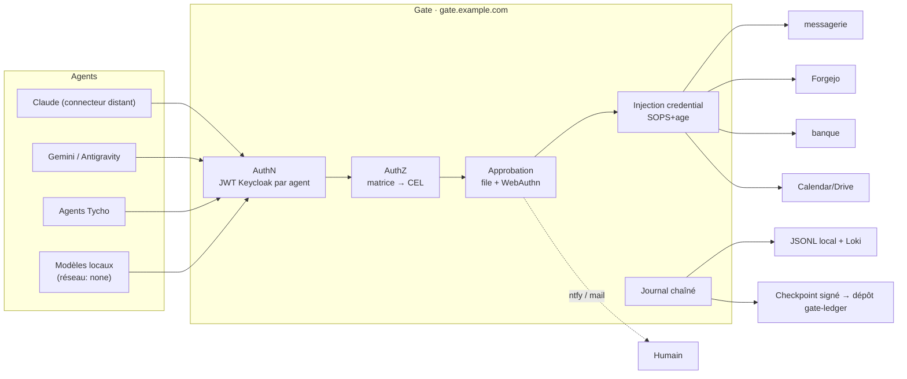

# RFC-002 : Gate

> **Statut** : Brouillon — revue cible **2026-11-03**, prototype **2026-11-27**, usage obligatoire **décembre 2026**
> **Auteur** : crapougnax
> **Parent** : RFC-001 (§6 Secrets et clés, §7ter Modes d'exécution et journal chaîné)
> **Point de départ** : registre interne des accès IA (v0.1)
> **Nom** : provisoire (voir §11)

---

## 0. Contexte et motivation

Un premier inventaire des accès IA fait apparaître une situation courante :

- **Assistants en ligne** : droits étendus accordés via les connecteurs de leur fournisseur (messagerie, stockage, agenda, banque, dépôts de code, y compris envoi, partage, suppression et opérations financières), **non justifiés par un usage, jamais revus**.
- **Agents de développement** : périmètre non inventorié ; un agent a déjà écrit un jeton en clair dans un dépôt.
- **Modèles locaux** : présents sur les postes, non inventoriés.

Chaque outil IA détient ses propres droits, chez son propre fournisseur, sans matrice commune ni journal commun. Comme pour RFC-001 : **une consigne n'est pas un contrôle**.

Contrôles ISO/IEC 27001:2022 visés : A.5.9 (inventaire), A.5.15 / A.5.18 (contrôle et droits d'accès), A.5.19–A.5.23 (fournisseurs, services cloud), A.8.2 (accès privilégiés), A.8.5 (authentification), A.8.15 / A.8.16 (journalisation, surveillance).

---

## 1. Principes (normatifs)

1. **Point d'entrée unique** : un agent n'atteint un service tiers que par le Gate.
2. **Les clés ne quittent jamais le Gate** : l'agent présente sa propre identité (jeton court Keycloak) ; le Gate injecte le credential amont. Aucun *token passthrough*.
3. **Refus par défaut** : un outil non classé ou non accordé est **invisible** (filtré de `tools/list`) et refusé s'il est appelé.
4. **Approbation humaine liée aux paramètres exacts** pour les classes sensibles.
5. **Tout passe au journal chaîné** (schéma RFC-001 §7ter, étendu §6).
6. **Un modèle local est un agent comme un autre** : identité, ligne dans la matrice, aucun réseau propre.
7. **Le contrôle réel est l'absence de credential** : un agent qui contourne le Gate ne trouve rien à utiliser.

---

## 2. Vocabulaire

| Terme | Définition |
| :--- | :--- |
| **Agent** | Principal non humain : outil IA (Claude, Gemini…), agent Tycho, ou modèle local. Un client Keycloak par agent. |
| **Service** | Système tiers atteint via le Gate : `mail`, `forgejo`, `bank`, `gcal`, `gdrive`… |
| **Action** | Outil MCP (ou opération HTTP) d'un service, rattaché à **une** classe. |
| **Classe** | `read`, `write`, `send` (sortie vers un tiers : mail, publication, commentaire), `delete`, `exec`, `financial`. |
| **Credential amont** | Secret permettant au Gate d'agir sur un service (OAuth refresh token, clé API, token Forgejo scopé). Détenu par le Gate seul. |
| **Approbation** | Décision humaine, à usage unique, liée à l'empreinte des paramètres d'un appel. |
| **Modèle autorisé** | Entrée `accepted` du registre des modèles (§7). |

---

## 3. Architecture



| Composant | Rôle | Choix proposé |
| :--- | :--- | :--- |
| Plan de données MCP | Multiplexage des serveurs amont, authentification JWT, filtrage des outils, autorisation par outil | **agentgateway** (Rust, Agentic AI Foundation) : règles CEL par outil, JWT validé contre Keycloak, multiplexage de plusieurs serveurs MCP — **à valider par spike** (§9). Repli : proxy Bun sur le SDK MCP TypeScript. |
| Matrice RBAC | Source de vérité unique | `gate/policy.yaml` dans le dépôt d'instance ; compilée en CEL par `tycho gate policy build` ; revue par MR. |
| Approbation | File, notification, décision | Service Bun (module `tycho gate`) ; push via **ntfy** auto-hébergé + mail TEM ; décision sur page derrière Keycloak avec **WebAuthn**. |
| Credentials amont | Coffre | SOPS + age (RFC-001 §6) en v1 ; OpenBao seulement si multi-instances. |
| Adaptateurs amont | Accès aux services | Serveur MCP de l'éditeur quand il existe, sinon adaptateur HTTP minimal par service. |
| Journal | Preuve | JSONL chaîné (§6). |

Le Gate est une **stack** du catalogue (`catalog/stacks/gate`), parité k8s / Podman (RFC-001 §5). Exposition : `gate.example.com` derrière Traefik + CrowdSec — **obligatoirement joignable d'Internet** pour les clients cloud (connecteurs claude.ai), via OAuth 2.1 conforme à la spécification MCP.

### Défense contre la substitution d'outils

Le Gate **épingle l'empreinte du schéma** (nom, description, paramètres) de chaque outil amont. Toute modification côté serveur amont désactive l'outil jusqu'à revue : une description réécrite est un vecteur d'injection (*tool poisoning*, *rug pull*).

---

## 4. Matrice RBAC

```yaml
apiVersion: gate.tycho/v1
agents:
  claude-web:        { client: gate-claude-web,  owner: admin-1, mode: standard }
  gemini-antigravity:{ client: gate-gemini,      owner: admin-1, mode: standard }
  local-coder:       { client: gate-local-coder, owner: admin-1, mode: hardened, model: <id registre> }

services:
  mail:
    credential: sops://gate/mail.enc.yaml
    actions:
      search_threads: read
      get_thread:     read
      create_draft:   write
      send_message:   send
      trash_thread:   delete
  bank:
    credential: sops://gate/bank-readonly.enc.yaml
    actions:
      list_transactions:            read
      create_multi_transfer_request: financial
      create_card:                  financial

grants:
  - { agent: claude-web, service: mail, allow: [read, write], approve: [send] }
  - { agent: claude-web, service: bank, allow: [read] }
  - { agent: "*",        service: "*",   deny: [financial] }   # v1 : aucun agent
```

Défauts par classe et par mode (un `grant` ne peut que **restreindre** ces défauts, jamais les élargir) :

| Classe | `sandbox` | `standard` | `hardened` |
| :--- | :--- | :--- | :--- |
| `read` | si accordé | si accordé | si accordé |
| `write` | si accordé | si accordé | si accordé |
| `send` | approbation | approbation | approbation |
| `delete` | approbation | approbation | **interdit** |
| `exec` | approbation | approbation | approbation + double |
| `financial` | interdit | interdit | interdit |

Règles :

- Action non classée ⇒ refusée. Classer une action = MR sur `policy.yaml`.
- Le credential amont a lui-même le **scope minimal** de l'union des grants (ex. clé banque lecture seule tant que `financial` est interdit) : la matrice n'est pas la seule barrière.
- Le mode de l'agent suit RFC-001 §7ter et apparaît dans chaque événement.

---

## 5. Approbation humaine

1. L'agent appelle une action à approuver ⇒ le Gate crée une demande `{id, agent, service, action, params, sha256(params canonicalisés), expire: +15 min}` et répond à l'agent : **en attente**, avec l'`id`.
2. Notification push (ntfy) + lien.
3. L'humain s'authentifie (Keycloak, **WebAuthn**), voit les **paramètres complets** (destinataire, corps, montant…), approuve ou refuse.
4. L'agent relance via l'outil méta `gate_approval_status(id)` ; le Gate exécute **exactement** les paramètres hachés. Toute différence = nouvelle demande. Usage unique.
5. Expiration ⇒ refus.

Garde-fous :

- Un agent ne voit jamais l'outil d'approbation.
- **Fatigue d'approbation** : plus de 10 demandes / jour sur la même action ⇒ la matrice est mal réglée, revue obligatoire (pas de « tout approuver »).
- Approbateur de secours désigné (§11) ; sans approbateur disponible, l'action attend.

---

## 6. Journal chaîné

Schéma RFC-001 §7ter, champs ajoutés :

| Champ | Contenu |
| :--- | :--- |
| `gate.agent`, `gate.service`, `gate.action`, `gate.class` | Identité et action |
| `decision` | `allow` / `deny` / `pending` / `approved` / `rejected` / `expired` |
| `policy` | SHA git de `policy.yaml` appliqué |
| `approval` | `id`, approbateur, horodatage |
| `params_hash`, `response_hash` | Empreintes — **pas le contenu** |
| `upstream` | Statut HTTP / MCP amont, durée |

- **Minimisation** : ni corps de mail, ni pièce jointe, ni relevé bancaire au journal. Métadonnées et empreintes seulement (RGPD).
- **Ancrage** : toutes les heures, checkpoint `{seq, head}` signé **minisign** et commité dans un dépôt `gate-ledger` sur Forgejo. Une falsification du journal devient détectable sans faire confiance au Gate.
- `tycho gate verify` recalcule la chaîne et confronte les checkpoints.
- Rétention : 12 mois (à aligner sur la politique SMSI).

---

## 7. Couche modèles locaux

### 7.1 Registre

`gate/models.yaml` dans le dépôt d'instance, commits signés :

```yaml
- id: <famille>-<taille>-<quant>
  vendor: <éditeur>            # ex. Alibaba (Qwen), DeepSeek, Zhipu (GLM), Moonshot (Kimi)
  origin: CN
  source: hf://<org-officielle>/<repo>@<commit-sha>
  license: <SPDX>
  format: gguf                 # ou safetensors
  quantized_by: <org> (llama.cpp <tag>) from <sha256 safetensors>
  files:
    - { name: model.gguf, sha256: <…> }
  signature: oms://<bundle>    # OpenSSF Model Signing
  eval: { report: okf://…, date: 2026-11-xx, result: pass }
  uses: [code, résumé]         # usages autorisés
  excluded: [synthèse géopolitique, décision]
  label: provisional           # accepted | negotiated | provisional
```

### 7.2 Provenance et empreinte

- **Source** : dépôt de l'éditeur officiel uniquement, **épinglé par commit**. Quantifications tierces tolérées en `sandbox` seulement.
- **Formats** : safetensors ou GGUF. **Pickle refusé** (`.bin`, `.pt`, `.pth`, `.ckpt`) : exécution de code au chargement.
- **`trust_remote_code` interdit** : code Python livré avec le modèle.
- **Quantification par nos soins** (llama.cpp épinglé) : artefact reproductible, empreinte connue.
- **Signature** de l'artefact final avec une clé de l'organisation au format **OMS** (bibliothèque `model-signing` de l'OpenSSF, v1.0, qui accepte aussi des paires de clés hors Sigstore) ; vérification à chaque chargement.
- **Import** : seul `tycho gate model import` télécharge (conteneur dont la sortie réseau est limitée à `huggingface.co`), vérifie, quantifie, signe et dépose dans un magasin **en lecture seule**. Le runtime ne télécharge jamais.

### 7.3 Évaluation (avant `accepted`)

| Étape | Outil | Critère |
| :--- | :--- | :--- |
| Scan statique | `modelscan` / `picklescan` | Aucun opcode dangereux |
| Licence et origine | Revue | Compatible avec les usages déclarés |
| Usage d'outils | **garak** (NVIDIA) + jeux `promptfoo` maison | Résistance à l'injection de prompt ; aucun appel d'outil non demandé |
| Exactitude factuelle et biais | Jeu de questions OKF maison | Documenté ; **restreint les usages**, ne bloque pas |

**Limite assumée** : aucune évaluation ne prouve l'absence de porte dérobée dans des poids. La mitigation est **l'isolement (§7.4) et la matrice (§4)**, pas le test.

### 7.4 Isolement réseau

- **Runtime** : `llama-server` (llama.cpp) — surface minimale ; vLLM si GPU le justifie. Ollama / LM Studio : `sandbox` uniquement (téléchargement et mises à jour intégrés).
- **Podman** : `--network=none`, socket Unix monté vers le Gate, poids montés `ro`, GPU NVIDIA via CDI.
- **Kubernetes** : `NetworkPolicy` egress deny-all ; ingress depuis le Gate seul.
- **Mac (Apple Silicon)** : un conteneur n'accède pas au GPU Metal ⇒ l'inférence locale sur le Mac reste **native, donc non isolée** ⇒ `sandbox` seulement. L'inférence `standard` / `hardened` tourne sur le **serveur IA interne** (Linux, Podman).
- Le modèle n'a **aucun outil propre** : ses appels passent par le Gate sous l'identité `local-<id>`. Défaut : `read` seul ; jamais `send`, `delete`, `financial`.

---

## 8. Ce que le Gate ne couvre pas (et comment on ferme)

| Contournement | Fermeture |
| :--- | :--- |
| **Connecteurs natifs claude.ai** (messagerie, Drive, Calendar, banque) : exécutés chez Anthropic avec les droits OAuth accordés, invisibles du Gate | Déconnexion en décembre ; le Gate devient **l'unique connecteur personnalisé**. Idem intégrations Google côté Gemini. |
| **Shell agent** (Claude Code, Antigravity, VM du poste) : peut joindre le réseau | Aucun credential de service tiers sur le poste (`gh`, `~/.config/*`, `.env`) ; scan de secrets (RFC-001 §7.1) ; pare-feu applicatif sortant (LuLu) en `hardened`. |
| **Navigateur piloté** avec sessions ouvertes (Chrome, computer use) | Interdit sur les domaines des services du Gate ; profil navigateur dédié aux agents, sans session. |
| **Credentials révoqués trop tard** | Rotation de tous les credentials existants à la bascule : un secret vu par un agent est un secret compromis (RFC-001 §6). |

---

## 9. Plan

| Jalon | Date | Livrable | Critère de sortie |
| :--- | :--- | :--- | :--- |
| RFC | 2026-11-03 | RFC-002 acceptée ; matrice v0 remplie depuis le registre | Questions §11 tranchées |
| Spike plan de données | 11-04 → 11-06 | agentgateway + Keycloak + Forgejo | Outils filtrés par agent, refus par défaut prouvé, empreinte des schémas faisable. Sinon : bascule proxy Bun |
| Prototype | 2026-11-27 | `gate.example.com` : forge, messagerie, banque en lecture ; approbation ntfy + WebAuthn ; journal chaîné + checkpoint ; registre modèles + import + 1 modèle isolé sur serveur IA | Démo : mail envoyé après approbation, suppression refusée, `tycho gate verify` OK |
| Bascule | 12-01 → 12-15 | Déconnexion des connecteurs natifs, rotation des credentials, Gate seul détenteur | Registre des accès IA : chaque entrée pointe vers une ligne de la matrice ; zéro droit direct |
| Usage obligatoire | 2026-12-15 | Mode `standard` par défaut | Tout accès hors Gate = incident |

Preuves SMSI : registre v0.1 et la présente RFC dès la collecte du 2026-11-01 ; journal du Gate dès la bascule.

---

## 10. Alternatives écartées

- **Proxy Bun maison d'emblée** : contrôle total, mais réimplémente authentification et parsing MCP. Conservé en repli.
- **Pomerium** (autorisation par outil, auto-hébergeable) : alternative crédible si le spike agentgateway échoue.
- **Gateways SaaS** (AWS AgentCore, Cloudflare, Kong Konnect) : dépendance cloud contraire à RFC-001 (k8s vanilla, souveraineté).
- **Cedar / OPA** : CEL natif suffit pour une matrice RBAC ; à réévaluer si les règles contextuelles (ABAC) se multiplient.
- **Statu quo** (chaque outil gère ses droits) : c'est le problème.

---

## 11. Questions ouvertes

- **Nom** : univers Tycho Brahe — *Uraniborg*, *Armille*, *Gnomon*.
- **Approbateur de secours** en l'absence de l'approbateur principal (à désigner).
- **`financial`** : interdit définitivement, ou approbation + SCA banque en v2 ?
- **Gemini / Antigravity** : support d'un serveur MCP distant avec OAuth — à vérifier pendant le spike.
- **Exposition publique** de `gate.example.com` : restreindre aux plages IP sortantes des fournisseurs si elles sont publiées.
- **RGPD** : métadonnées de mails au journal = données personnelles ; analyse d'impact légère à joindre.
- Articulation avec la RFC fille « Gestion des clés » (RFC-001 §10.1) : credentials des services tiers inscrits au ledger (**RFC-003**), Gate enregistré comme consumer, DLP sortante par empreintes du ledger.

---

## Références

- agentgateway — MCP authorization : <https://agentgateway.dev/docs/standalone/latest/mcp/mcp-authz/>
- OpenSSF Model Signing v1.0 : <https://openssf.org/?p=8118>
- RFC-001 : `docs/rfcs/rfc-001-stacks-plugins-targets.md`
- Registre des accès IA : registre interne de l'organisation (SMSI)
